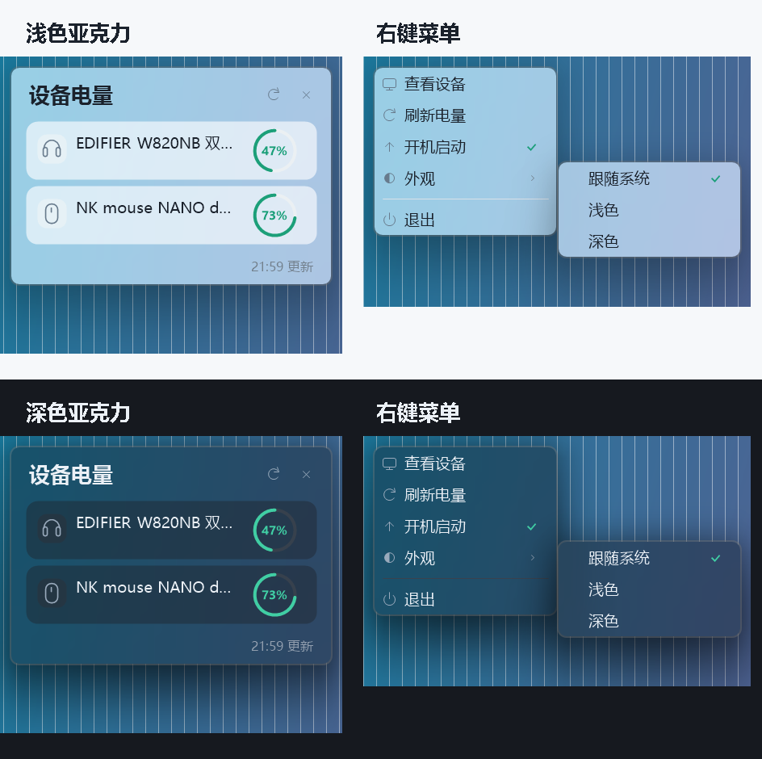

# 外设工具箱

轻量 Windows 托盘应用，首个功能是查看无线外设电量。点击托盘图标查看已连接的蓝牙和无线接收器设备。



## 使用

下载 Release 中的 `PeripheralBattery.exe` 并双击。首次运行会安装到当前用户的 `%LOCALAPPDATA%\PeripheralBattery`，启用开机启动并显示托盘图标。安装使用当前用户权限。

左键打开设备列表，右键可以刷新、切换开机启动或退出。后台每 60 秒刷新一次，打开列表时也会刷新。需要调整托盘可见性时，可以在 Windows 的托盘设置中将图标设为常显。

拖动窗口顶部标题或空白区域可以移动位置，刷新、收起按钮保留各自操作。本次运行中再次打开窗口会保留拖动后的位置，设备列表刷新也会保留位置。重启应用后恢复托盘附近的默认位置。

拖动过程中实时限制在鼠标所在显示器的桌面可用区域内，窗口碰到边缘即停止，任务栏区域会被避开。跨屏时按鼠标所在屏幕更新边界。松开鼠标、刷新和显示器布局变化时再次校正位置。可用高度较小时压缩列表显示区域，保留滚动。

有效电量百分比低于 20% 时发送 Windows 原生托盘通知，点击通知可查看设备。20% 整不触发。持续低电量、暂时断连和重启应用不会反复提醒，观察到电量回升至 20% 及以上后重新启用该设备的提醒。多台设备同时低电量时合并通知。只有低、中、满档位且没有百分比的设备继续显示档位，暂不触发百分比阈值通知。提醒记录保存在当前用户设置中。

右键菜单的“外观”提供“跟随系统、浅色、深色”三个选项，默认跟随 Windows 应用主题。选择会保存在当前用户设置中，面板、菜单和子菜单同步切换。托盘使用 C1 电量环图标，图标颜色单独跟随 Windows 任务栏主题，以保持对比度。

v0.7.0 的面板、右键菜单和子菜单使用 Windows 原生半透明亚克力，卡片保留半透明底色与清晰的电量数字。Windows 11 22621 及以上支持此效果，旧版 Windows 使用实色界面。系统关闭透明效果或进入节能状态时，由 Windows 处理材质回退。亚克力窗口的模糊合成会使用额外 GPU 资源。[Microsoft 亚克力说明](https://learn.microsoft.com/en-us/windows/apps/design/style/acrylic)

v0.4.0 调整托盘图标的占位和线条粗细，新增与 C1 统一的彩色应用图标，嵌入 EXE 的 16–256 像素多尺寸图标资源。修复外观子菜单与主菜单之间的间隙，并处理屏幕边缘向左展开。

主界面显示设备图标、名称、连接标记和圆环电量，百分比位于圆环中心。电量减少时，从顶部开始顺时针退去，灰色缺口逐渐增加。未知电量以“—”显示，档位电量以低、中、满等文字显示。悬停卡片显示完整设备名、连接方式和电量。窗口高度随设备数量调整，超过五台时可以滚动查看。

托盘悬停使用“设备类型图标＋电量”的多行短提示，耳机、鼠标、手柄和键盘分别标识。大量设备超出 Windows 原生短提示容量时，显示额外设备数量，点击托盘查看完整列表。

USB 直连设备会被隐藏，包括有线键鼠和通过 USB 数据线连接的手柄。蓝牙按设备父级链及 Windows 蓝牙连接状态识别，接收器按已验证的设备协议识别。仅有 USB 接口且无法确认无线连接的设备也会被隐藏，后续添加接收器协议可扩展识别范围。XInput 手柄仅在驱动明确标记无线时显示；若驱动无法区分蓝牙与接收器，界面标为“无线”。

Windows“已安装的应用”中可卸载“外设工具箱 Peripheral Toolbox”。卸载前从托盘退出应用。

需要免安装运行时，使用 `PeripheralBattery.exe --portable`。诊断命令为 `PeripheralBattery.exe --diagnose report.txt`，报告包含设备名称、连接类型和电量结果。

## 跨品牌兼容

发现设备与读取电量分别处理。发现到的无线设备会列入列表，未获取电量时显示“—”。读取来源和协议详情保留在诊断报告中。

| 读取方式 | 适用范围 | 当前状态 |
| --- | --- | --- |
| Windows 设备电量 | 系统上报电量的蓝牙设备 | 已实现，按物理设备连接状态过滤 |
| Windows 蓝牙实时属性 | 已连接的经典蓝牙和 BLE 设备 | 已实现，作为系统属性的另一来源 |
| BLE 标准电池服务直读 | 提供 Battery Service / Battery Level 的已连接设备 | 已实现，直接读取设备，兼容设备待实测 |
| 漫步者厂商蓝牙服务 | 提供 EDF00000 控制服务的已连接耳机 | W820NB 双金标版已实测成功 |
| 标准 HID Battery Strength | 描述符中声明标准电池 Feature 报告的设备 | 已实现，待兼容设备实测 |
| XInput 电池接口 | Xbox 及兼容手柄 | 已实现，保留低、中、满等档位 |
| DualSense HID 报告 | 原装 DualSense、DualSense Edge，蓝牙 | 原装 DualSense 蓝牙实测成功，Edge 待实测；USB 直连会隐藏 |
| ATK NK NANO | `373B:1216` 接收器，`FF05` 协议接口 | 本机已实测读取百分比 |
| 其他品牌私有接收器 | 自动发现输入设备，电量需要对应协议 | 按型号逐步适配 |
| 飞智黑武士 5 Pro | Flydigi V2 HID 查询 | 本机接收器实测成功，按 20% 档位显示 |

Windows 可能缓存蓝牙电量，因此显示系统最近上报值。DualSense 电量以约 10% 档位估算，诊断报告会记录该精度。接收器插着时外设可能休眠或关机，诊断中的“接口已发现”只代表接口可访问。第三方转换接收器还需要确认其向 Windows 暴露的协议。

XInput 接口只提供玩家槽位，部分无线驱动可能与同一手柄的 HID 项同时出现。驱动报告有线模式的 XInput 项会隐藏。设备电量是否可读取决于设备、固件、驱动和连接模式。标准接口与厂商协议适配共同扩展兼容范围。

## 构建与扩展

Windows 10/11，.NET Framework 4.8。使用系统自带 C# 编译器构建。

```powershell
powershell -ExecutionPolicy Bypass -File .\build.ps1
```

附带接口发现、报文与界面回归检查，可通过 `powershell -ExecutionPolicy Bypass -File .\build.ps1 -Verify` 运行。此检查覆盖蓝牙服务 UUID 形式的 HID 路径、无边框窗口尺寸、按钮命中、菜单点击和简洁提示。验证期间会短暂打开测试菜单。

源码采用 C# 与 WinForms，无 NuGet 包依赖。`IBatteryProvider` 接入系统级数据来源，`IHidBatteryReader` 接入设备协议。设备枚举按容器合并多个 HID 接口。添加品牌适配时应匹配具体协议接口并校验回复，仅发送已确认的电量查询。

增强蓝牙读取使用 Windows 自带的 WinRT 蓝牙、网络和流接口，构建脚本引用系统元数据和 .NET Framework 程序集。运行时持续保留系统属性读取作为回退。查询设有超时，单个设备失败后继续其他设备。漫步者查询匹配厂商服务 UUID 与物理地址，并校验返回帧。

设备扫描由同一 EXE 的短时后台读取进程执行，读取完成即退出，蓝牙运行库随读取进程释放。界面进程仅保留设备结果。扫描频率仍为每分钟一次，手动刷新也可启动读取。退出应用会终止尚未完成的读取。扫描期间总内存会短暂增加，空闲常驻内存与扫描峰值分别衡量。

发布时在本地构建 EXE，并将它与 SHA256 校验值上传到 GitHub Release。

## 第一版验证记录

2026-11-07，本机 ATK 接收器读取到 74%，飞智黑武士 5 Pro 接收器读取到 100%（20% 档位）。EXE 约 36 KB。初版界面的短时后台工作集约 42 MB，打开界面后约 59 MB。3 秒空闲采样的 CPU 时间增量为 0。测量结果随系统与设备变化。

v0.2.0 在 Windows 电量属性为空时，通过漫步者厂商服务实际读取 W820NB 双金标版电量 56%。本次增强的 EXE 约 44 KB。其他漫步者型号和 BLE 标准服务仍需设备实测。

v0.4.0 同机测得安装版打开面板后的私有工作集约 12 MB，旧安装版约 25.7 MB。开发预览进程的后台与打开面板状态分别约 6.3 MB、7.0 MB。该指标对应任务管理器常见的进程内存显示口径。扫描期间另有短时读取进程，峰值会增加。数值会随运行路径、Windows 缓存与设备数量变化。

v0.7.0 使用同一测试入口、同样两台外设与相同等待时间对比亚克力改版前后。托盘空闲私有工作集从 8.36 MiB 到 8.39 MiB，面板打开从 8.98 MiB 到 9.06 MiB，菜单与子菜单打开从 9.31 MiB 到 9.30 MiB。短时样本中的变化小于 1 MiB，Windows 合成器的显存与 GPU 开销未包含在这些进程内存数值中。连续重绘检查未发现 GDI 对象累积。

已检查 USB/蓝牙 DualSense 报文解析、异常电池值、短报文、未知接收器匹配、本机设备扫描、安装和自启注册。v0.6.1 原装 DualSense 蓝牙实际读取到 100%（10% 档位约值），修复了蓝牙 HID 路径过滤遗漏。其他型号仍需实机验证。

卸载通过将运行中的 EXE 移到系统临时目录完成，可能留下一份约 36 KB 的临时副本，供系统临时文件清理。首次发布版本尚无代码签名。

## 协议资料

- Windows XInput 电量接口。[Microsoft 文档](https://learn.microsoft.com/en-us/windows/win32/api/xinput/nf-xinput-xinputgetbatteryinformation)
- 标准 HID 值解析。[Microsoft 文档](https://learn.microsoft.com/en-us/windows-hardware/drivers/ddi/hidpi/nf-hidpi-hidp_getusagevalue)
- ATK 报文说明与开源实现。[atk-tool-plus](https://github.com/papelblume/atk-tool-plus)
- DualSense 报文说明与开源实现。[SDL](https://github.com/libsdl-org/SDL/blob/main/src/joystick/hidapi/SDL_hidapi_ps5.c)
- 漫步者电量帧与服务 UUID 资料，C# 查询实现独立编写。[mEDIFIER](https://github.com/wh201906/mEDIFIER)
- BLE 标准电池服务与直接读取接口。[Microsoft 文档](https://learn.microsoft.com/en-us/windows/uwp/devices-sensors/gatt-client)

应用以 MIT 许可证发布。协议参考项目的授权说明见 THIRD_PARTY_NOTICES.md。
